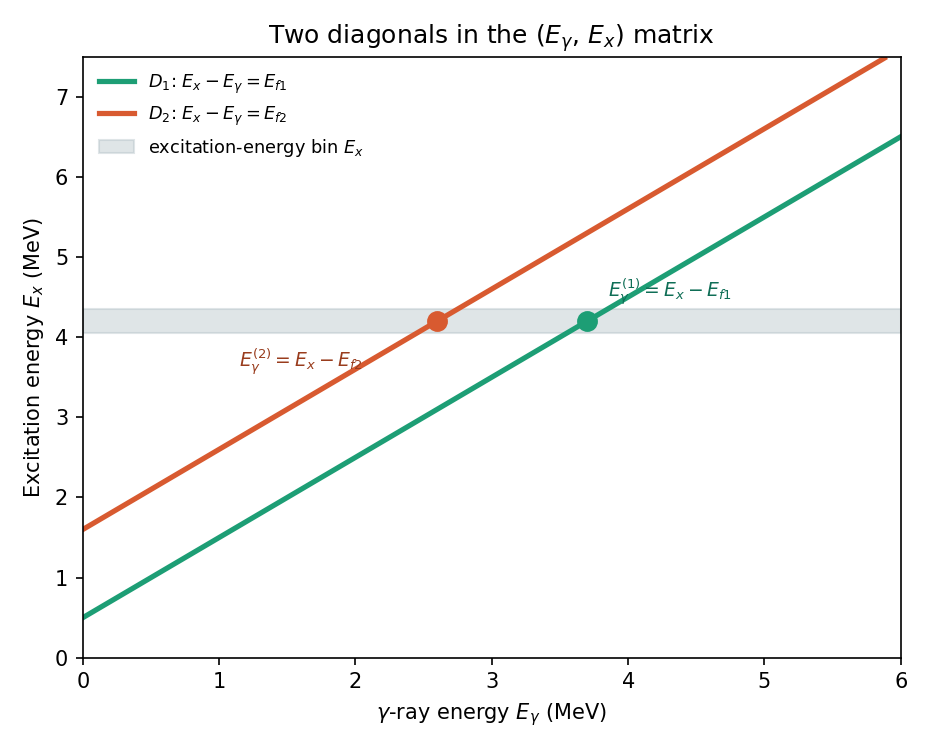
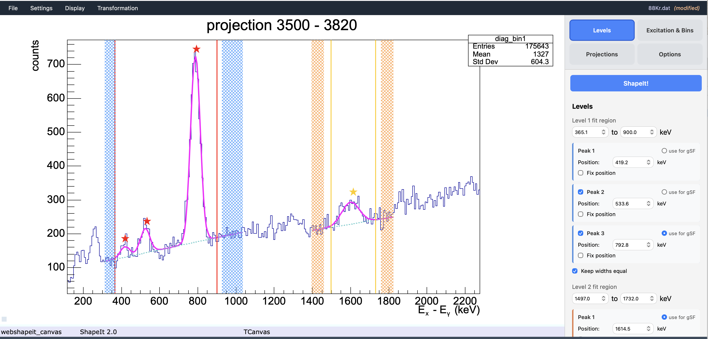

# 2. Defining the two levels

## The key idea: diagonals, not γ-ray windows

A primary γ ray that de-excites the quasicontinuum directly into a specific
low-lying final level $L_j$ obeys $E_x = E_\gamma + E_{Lj}$ — so in the
$(E_\gamma, E_x)$ matrix, all such transitions lie on a **diagonal line**,
regardless of which excitation-energy bin they started from. Equivalently,
along that diagonal, $E_x - E_\gamma = E_{Lj}$ is **constant**.

This is why ShapeIt can work with two simple energy windows instead of two
diagonal cuts: it internally re-bins the matrix onto an
$(E_x - E_\gamma)$ vs. $E_x$ grid, where each diagonal collapses to a
**vertical line** at $E_x - E_\gamma = E_{Lj}$ — i.e. at the (fixed) energy
of the fed level itself.

*Figure — Diagonals $D_1$ and $D_2$ in the $(E_\gamma, E_x)$ matrix,
corresponding to two known final levels. For a given excitation-energy bin
(grey band), the crossing points with $D_1$ and $D_2$ give a pair of γ-ray
energies, $E_\gamma^{(1)} = E_x - E_{f1}$ and $E_\gamma^{(2)} = E_x - E_{f2}$.*

## Setting the level windows

All level settings are in the **Levels** tab of the sidebar.

### Fit regions

The **Level 1 fit region** and **Level 2 fit region** define windows on the
$(E_x - E_\gamma)$ axis that bracket each final level's peak:

| Field | Meaning |
|---|---|
| Level 1 fit region (low – high) | Window on the **Ex − Eγ** axis bracketing the first final level's energy, $E_{L1}$ |
| Level 2 fit region (low – high) | Window on the **Ex − Eγ** axis bracketing the second final level's energy, $E_{L2}$ |

$L_1$ and $L_2$ are typically the two lowest, best-resolved discrete states
below the level density in your nucleus — in even–even nuclei, conveniently
the first two $2^+$ states. Replace the default placeholder values with the
known energies of the two final levels relevant to your nucleus.

!!! tip "How to pick good windows"
    Switch to the **Projections** tab and click **Diagonal projection (sum)**
    to view the matrix re-binned onto the $(E_x-E_\gamma)$ vs. $E_x$ grid.
    Your two chosen levels should appear as two clear vertical lines; set the
    Level 1 / Level 2 fit region windows to bracket each line with a small
    margin.

### Peak positions

Within each fit region, ShapeIt needs to know where the peak centre is. Each
level has a **Peak 1** section (always active) showing a **Position** field
and a **Fix position** checkbox.

- **Position** (keV) — the expected centre of the peak on the $(E_x-E_\gamma)$
  axis. In Autofit mode, this is used as the starting point for the
  Gaussian fit's centroid parameter.
- **Fix position** — when checked, the fit holds the centroid fixed at the
  stated position rather than letting it float. Useful when statistics are
  low or when a peak sits on a steep background that would otherwise pull
  the centroid.

Draggable **star markers** (★) on the projection plot (Autofit mode) show
the current peak positions and can be dragged interactively — the position
field updates automatically.

## Multiple peaks per level (doublet and triplet)

Sometimes a level's peak sits next to one or two contaminants — most
commonly a first-escape peak about 511 keV away (from pair-production
escape) — that you want to fit *simultaneously* so they don't bias the peak
of interest. ShapeIt 2.0 supports fitting up to **three peaks** within a
single fit region.

### Enabling Peak 2 or Peak 3

In the **Levels** tab, each level has collapsible **Peak 2** and **Peak 3**
sections:

1. Check the checkbox next to **Peak 2** (or **Peak 3**) to enable it.
2. A **Position** field and **Fix position** checkbox appear — set the
   expected centre of the contaminant peak.

When multiple peaks are active, the widths of all components within a fit
region are **kept equal** (shown by the greyed-out "Keep widths equal"
label below each level's peak sections — this constraint is always on when
more than one peak is active).

### Selecting the active peak for gSF

This is a key new feature in ShapeIt 2.0. Each peak section has a
**use for gSF** radio button. This controls *which* peak's integrated area
enters the γSF ratio $R$ — only one peak per level can be active at a time.

The default is always Peak 1. You would switch to Peak 2 or Peak 3 when the
physical level of interest is not the strongest peak in the fit window — for
example:

- Your level of interest is actually the **second-strongest** peak in the
  fit region, and you added a contaminant (Peak 1) to model a nearby line
  that is accidentally larger.
- You are fitting a **doublet where the second component is the level you
  want** — e.g. the physical $2^+$ transition sits right next to a strong
  escape peak, and you placed the escape peak as Peak 1 to keep it
  well-constrained, with the true level as Peak 2.

!!! note
    The "use for gSF" radio button for Peak 2 and Peak 3 is only enabled
    once that peak is activated by its checkbox. Peak 1's radio button is
    always available and is selected by default.

## Markers on the projection plot

When you display a diagonal projection (summed or per-bin) in Autofit mode
with background subtraction enabled, the canvas shows draggable markers:

{ width="80%" }

*A single excitation-energy bin's projection (3500–3820 keV), in Autofit mode
with a triplet configured for Level 1. The magenta curve shows the fitted
Gaussians. Red vertical lines mark the Level 1 fit region edges; orange lines
mark the Level 2 fit region edges. Hatched blue and orange boxes show the
background windows. Star markers (★) indicate each peak's fitted position.*

- **Red vertical lines** — left and right edge of the Level 1 fit region.
  Dragging updates the Level 1 fit region fields in the sidebar.
- **Orange vertical lines** — left and right edge of the Level 2 fit region.
  Dragging updates the Level 2 fit region fields in the sidebar.
- **Red stars** (★) — peak positions for Level 1 (Peak 1, Peak 2, Peak 3
  if enabled). Dragging updates the corresponding Position field.
- **Orange stars** (★) — peak positions for Level 2.
- **Hatched blue boxes** — background windows for Level 1.
- **Hatched orange boxes** — background windows for Level 2.

## Background regions

Each level has **two background windows** (one below, one above the peak,
on the same Ex − Eγ axis) used for background subtraction and for the peak
fit in Autofit mode. They are shown at the bottom of the **Levels** tab
under **Background (Level 1)** and **Background (Level 2)**, each with two
rows of low/high fields.

The corresponding hatched boxes on the projection plot can be dragged
directly — this is the normal way to adjust background windows without
typing into fields.

Next: [Choosing mode and binning](mode-and-binning.md).
