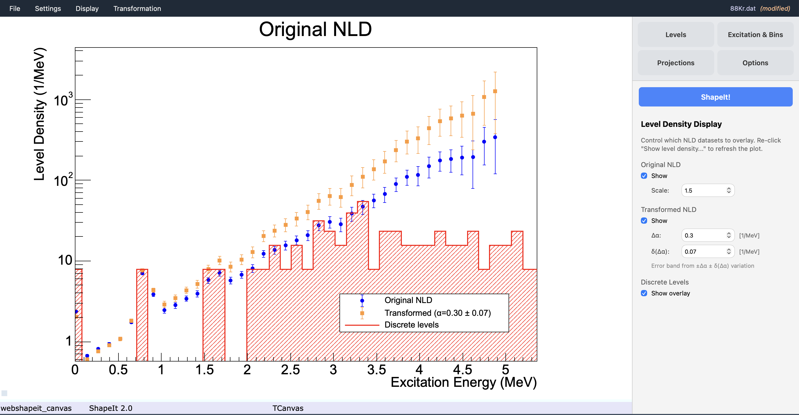

# 7. Viewing the level density

Once you have run ShapeIt and determined a slope correction $\Delta\alpha$
(e.g. from the Monte Carlo search described in
[chapter 6](monte-carlo-uncertainty.md)), you can visualise the corresponding
**absolute partial level density** and compare it directly with known discrete
levels. This is done through **Display → Show level density...**.

## Prerequisites

Before opening the level density view, make sure you have:

1. A **settings file** loaded (the file records the path to the NLD data).
2. An **NLD file** registered via **Settings → Load NLD literature (Oslo) data...**
   — a plain-text three-column file (`Ex  rho  d_rho`), typically the
   Oslo-method level density for the same nucleus.
3. *(Optional)* A **discrete levels file** loaded via
   **Settings → Load discrete levels data...** if you want to overlay the
   known low-energy discrete levels as a histogram.

## Opening the view

**Display → Show level density...** does two things simultaneously:

- Draws the level density plot on the main canvas.
- Opens the **Level Density Display** control panel in the sidebar (replacing
  whichever tab was previously visible).

To **refresh** the plot after changing any of the parameters below, click
**Display → Show level density...** again — the canvas re-renders with the
current panel settings.

## The Level Density Display panel

The sidebar panel has three sections, each controlling one overlaid dataset.

### Original NLD

| Control | Effect |
|---|---|
| **Show** | Toggles the original (unscaled, untransformed) Oslo NLD data points. Plotted as blue circles with error bars. |
| **Scale** | Multiplicative factor applied to every ρ value and its uncertainty before plotting. Use this to account for the **partial level density fraction** — e.g. if your Oslo data is a total NLD and you expect your measurement to see only a certain spin-parity window. Default: 1. |

!!! note "Automatic MeV → keV unit detection"
    If the maximum excitation energy in the NLD file is below 50, ShapeIt
    assumes the file is in **MeV** and auto-converts: energies × 1000,
    densities ÷ 1000. A warning appears in the message log when this fires.
    All other NLD files are assumed to already be in keV.

### Transformed NLD

This section applies the slope transformation derived from the Shape method
to produce the **corrected** level density.

| Control | Effect |
|---|---|
| **Show** | Toggles the transformed NLD curve and its error band. Plotted as orange triangles with an asymmetric fill band. |
| **Δα** [1/MeV] | The slope correction parameter. Set this to the $\delta\alpha$ returned by the Monte Carlo search (chapter 6). |
| **δ(Δα)** [1/MeV] | Uncertainty on $\Delta\alpha$. Setting this to the 1σ standard deviation from the MC Δα histogram produces a shaded error band. |

**Transformation formula.** The transformed level density at excitation energy
$E_x$ is:

$$\rho'(E_x) = C \cdot e^{\,\Delta\alpha\,[\mathrm{MeV}^{-1}]\;\cdot\; E_x[\mathrm{MeV}]} \cdot \rho(E_x)$$

where the normalisation constant $C$ is chosen so that $\rho'(E_x) = \rho(E_x)$
at $E_x = 0.5\,\mathrm{MeV}$ — i.e. the original and transformed curves
cross at 500 keV, anchoring the low-energy normalization to the discrete-level
counting regime.

**Error band.** ShapeIt evaluates the transformation at three slope values —
$\Delta\alpha$, $\Delta\alpha - \delta(\Delta\alpha)$, and
$\Delta\alpha + \delta(\Delta\alpha)$ — and builds a point-by-point
**asymmetric** error band. The half-widths at each $E_x$ are:

$$\sigma_\pm(E_x) = \sqrt{\bigl|\rho'_\pm(E_x) - \rho'(E_x)\bigr|^2 + \sigma_{\rho'}^{2}(E_x)}$$

where $\sigma_{\rho'}$ is the propagated statistical error of the transformed
central value. The band therefore reflects both the slope uncertainty *and*
the original data uncertainties, added in quadrature.

### Discrete Levels

| Control | Effect |
|---|---|
| **Show overlay** | Overlays the known low-energy discrete levels as a red hatched histogram. Requires a discrete levels file to be loaded (see prerequisites above). |

The discrete-levels file is a two-column plain-text file (`Ex[keV]  N_states`).
ShapeIt draws it as a step histogram on the same y-axis as the NLD, providing
a visual check that the Oslo NLD smoothly connects onto the counting-of-levels
regime at low $E_x$.

## Example

{ width="80%" }

*Level density view: original Oslo NLD (blue circles), slope-corrected NLD
(orange triangles) with the $\pm\delta(\Delta\alpha)$ error band (shaded), and
the known discrete levels (red histogram). Here $\Delta\alpha = 0.30\,\mathrm{MeV}^{-1}$
and $\delta(\Delta\alpha) = 0.07\,\mathrm{MeV}^{-1}$ from the Monte Carlo
search. The transformed curve crosses the original at 500 keV (the
normalization anchor).*

## Typical workflow

1. Complete the Monte Carlo slope search (chapter 6) and note
   $\delta\alpha \pm \sigma_\alpha$.
2. Open **Display → Show level density...**
3. In the **Level Density Display** panel:
   - Set **Δα** = $\delta\alpha$ and **δ(Δα)** = $\sigma_\alpha$.
   - Enable **Transformed NLD → Show**.
   - Optionally adjust **Scale** to account for the partial level density fraction.
4. Click **Display → Show level density...** again to refresh the canvas.
5. Compare the transformed curve with the discrete-levels histogram — a
   consistent result will have the transformed NLD touching or smoothly
   approaching the counting histogram at low $E_x$.

## Saving the configuration

**Δα**, **δ(Δα)**, **Scale**, and the three Show/hide toggles are all stored
in the settings file. Use **Settings → Save settings** after configuring the
display so that the same view can be reproduced in a later session without
re-entering the parameters.
