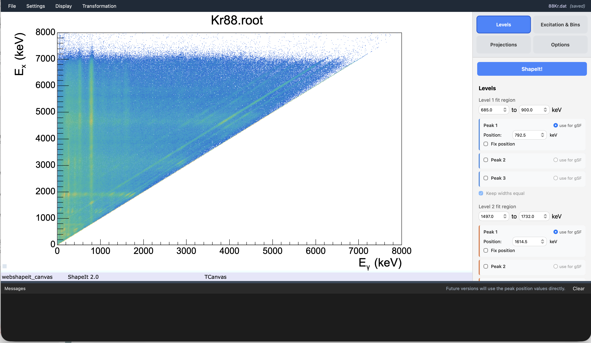

# 1. Loading a matrix

## Open a ROOT file

From the menu bar, choose **File → Open matrix...** to open the file browser
dialog. Navigate to your `.root` file and click **Open**.

Once loaded:

- The **Matrix** dropdown in the **Options** tab is populated with every
  `TH2` found in the file.
- The matrix is displayed automatically in the main canvas.

## Inspect the raw matrix

The main canvas shows the raw $(E_\gamma, E_x)$ matrix in COLZ style with a
logarithmic colour scale, to confirm it looks as expected before doing any
analysis.

To view other representations, switch to the **Projections** tab in the
sidebar:

| Button | Shows |
|---|---|
| **Matrix** | The raw $(E_\gamma, E_x)$ matrix as loaded |
| **Diagonal projection (sum)** | The matrix re-binned onto ShapeIt's internal $(E_x-E_\gamma)$ vs. $E_x$ grid — this is where diagonals become vertical lines (see [Defining the two levels](defining-levels.md)) |
| **Projection of bin** (dropdown) | The $(E_x-E_\gamma)$ projection for a single selected excitation-energy bin (available after running ShapeIt at least once) |

!!! tip
    If the matrix looks empty, transposed, or the axes look swapped, double
    check the axis convention in [Input data format](../data-format.md) —
    ShapeIt expects **Eγ on x, Ex on y** for the raw input matrix, both in
    keV. The "Diagonal projection" view is a different, re-binned
    representation (Ex − Eγ vs. Ex) that ShapeIt builds internally — see
    [Defining the two levels](defining-levels.md) for why.

## The interface at a glance

Before going through the workflow step by step, here's a quick map of the
ShapeIt 2.0 interface.

{ width="90%" }

*The ShapeIt 2.0 browser interface after loading `Kr88.root`. The canvas shows
the $(E_\gamma, E_x)$ matrix with a logarithmic colour scale. The sidebar on
the right shows the **Levels** tab with the Level 1 and Level 2 fit regions,
peak positions, and the **ShapeIt!** run button at the top.*

The interface has four areas:

| Area | Description |
|---|---|
| **Menu bar** (top) | File, Settings, Display, and Transformation menus; settings filename and save-state indicator on the right |
| **Sidebar** (right) | Four tabs — Levels, Excitation & Bins, Projections, Options — plus the **ShapeIt!** run button at the top |
| **Canvas** (centre) | All plots rendered by JSROOT: matrix, projections, gSF results, Monte Carlo summary |
| **Log panel** (bottom) | Timestamped status messages from the backend; can be cleared with the **Clear** button |

### Sidebar tabs

| Tab | Purpose |
|---|---|
| **Levels** | Define the fit windows and peak positions for Level 1 and Level 2, and their background regions |
| **Excitation & Bins** | Set the excitation-energy range, bin size, min. counts, gSF scaling, and efficiency correction |
| **Projections** | Display the matrix or per-bin projections in the canvas |
| **Options** | Select the input matrix, choose Integration vs. Autofit mode, and toggle analysis options and display settings |

Two additional panels are opened via the menu rather than as tabs:

| Menu item | Panel |
|---|---|
| **Display → Width calibration...** | View and edit the linear peak-width calibration |
| **Transformation → Slope correction...** | Apply a manual slope transformation or run the Monte Carlo α search |

Next: [Defining the two levels](defining-levels.md).
