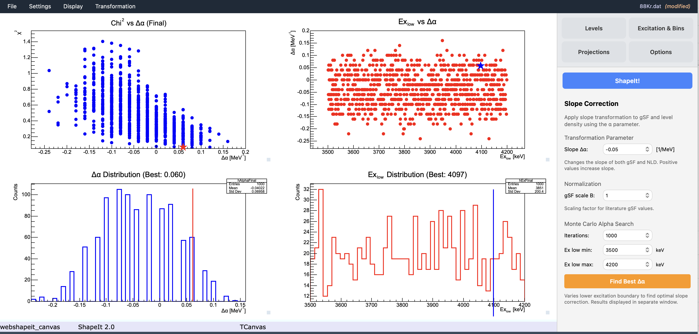

# 6. Monte Carlo uncertainty and absolute level density

Once you have a sewn γSF you're happy with, the final step is to compare it
with an Oslo-method result for the same data set, determine the slope
correction $\alpha$, and — if you also load an Oslo-method level density —
turn that into an **absolute partial level density**.

## Load the comparison (Oslo-method) data

Under **Settings → Load gSF literature (Oslo) data...**, load the Oslo-method
γSF for the same nucleus/data set. Enable **Display expectation** in the
**Options** tab to overlay it with your sewn result.

!!! warning "MeV vs keV in literature files"
    When loading an Oslo-method gSF file, ShapeIt checks whether the
    γ-ray energies appear to be in MeV (all values below a threshold).
    If so, a warning dialog is shown offering to convert them to keV
    automatically. Confirm the conversion or cancel and convert the file
    manually — see [Settings files](../settings-files.md#load-gsf-literature)
    for the expected file format.

## Open the Slope Correction panel

**Transformation → Slope correction...** opens the **Slope Correction** panel
in the sidebar (replacing whichever tab was active). It has three sections.

### Transformation Parameter

- **Slope Δα** — the slope parameter of the Oslo transformation (in
  MeV$^{-1}$). Changing this rescales the slope of both the extracted gSF
  and the level density live, so you can see the effect interactively.
  Positive values increase the slope.

### Normalization

- **gSF scale B** — overall scaling factor for the literature gSF values.
  Adjust until the overlaid literature curve matches your sewn result at
  the desired normalization.

### Monte Carlo Alpha Search

This is the main quantitative determination of $\delta\alpha$ and its
uncertainty.

| Field | Meaning |
|---|---|
| **Iterations** | Number of Monte Carlo iterations (typically 100–1000) |
| **Ex low min** | Lower bound for randomizing the lower excitation-energy edge (keV) |
| **Ex low max** | Upper bound for the same (keV) |

Click **Find Best Δα** to start. The button is replaced by a **Stop** button
while the simulation runs, so you can interrupt a long run early.

!!! important "Why the lower edge matters"
    The extracted slope correction $\delta\alpha$ depends on which γ-ray
    energies are included in the χ² comparison between the Shape-method γSF
    and the literature γSF. The Shape method relies on the nucleus behaving
    statistically, which breaks down at **low excitation energy**, where
    individual levels and non-statistical structure dominate. Including bins
    that are too low biases the slope. Varying the lower edge of the
    excitation-energy range is what lets the Monte Carlo fold this sensitivity
    into $\delta\alpha$ and its uncertainty. Choose the **Ex low min / max**
    window so it stays within the range where the Shape method is valid for
    your nucleus.

On each iteration, ShapeIt redraws:

1. the excitation-energy bin width (uniformly, over the same range as the
   bin-size scan),
2. the lower edge of the excitation-energy range (uniformly, over the
   Ex low min/max range set above),
3. the peak areas of both diagonals in every accepted bin (from a Gaussian
   centred on the fitted value, width = its statistical uncertainty), and
4. the comparison γSF data itself (from a Gaussian centred on each published
   point, width = its quoted uncertainty),

then repeats diagonal extraction, peak fitting, and symmetric sewing from
scratch, and records the best-fit $\alpha$ from a χ² comparison against the
(resampled) comparison curve.

### Watching the run

While the Monte Carlo runs, the canvas shows the current iteration's
Shape-method γSF overlaid with that iteration's *resampled* literature γSF —
both curves change from iteration to iteration. The display refreshes every
10th iteration to avoid slowing the calculation.

## Reading the result

{ width="80%" }

*Four-panel Monte Carlo summary for* `88Kr`*. Top left: χ² vs Δα for all
iterations. Top right: Ex_low vs Δα scatter. Bottom left: histogram of
best-fit Δα values — the label "Best: 0.060" marks the single iteration
with the lowest χ², but the centroid of the distribution (here around
−0.05) is the more reliable estimate. Bottom right: distribution of
randomly drawn Ex_low values.*

On completion (or after pressing **Stop**), ShapeIt shows a four-panel
summary in the canvas:

- **χ² vs Δα** — the χ² landscape across all iterations, showing the
  single iteration with the lowest χ².
- **Ex_low vs Δα** — how the best-fit slope varies with the randomly drawn
  lower excitation-energy edge, giving a sense of the sensitivity to that
  choice.
- **Δα distribution** — histogram of the best-fit Δα recorded in each
  iteration.
- **Ex_low distribution** — histogram of the randomly drawn lower
  excitation-energy values across all iterations.

## Choosing your slope correction value

The four-panel summary labels each histogram with the value from the
**single iteration that achieved the lowest χ²** (shown as "Best: ..." in
the histogram title). This is *not* necessarily the best value to use.

A single iteration with a slightly lower χ² may simply have drawn a
favourable random combination of bin width, Ex_low, and peak areas —
it doesn't mean that Δα is physically more likely to be correct. The
**centroid of the Δα distribution** (bottom-left panel) is a more robust
estimate: it reflects where the *majority* of iterations converge, averaging
out the random draws rather than picking the luckiest one.

!!! tip "Use the distribution centroid, not the χ² minimum"
    Read the centroid of the Δα histogram as your best estimate of the
    slope correction. The spread (standard deviation) of the distribution
    is your 1σ uncertainty. The χ² minimum shown in the panel title is a
    useful sanity check but should not be used directly as the slope
    correction value.

To apply your chosen Δα, type it into the **Slope Δα** field at the top of
the Slope Correction panel and press Enter — the overlaid literature curve
updates immediately so you can see the effect on the gSF plot.

## Getting to the absolute partial level density

$\delta\alpha$ is exactly the parameter that the level density at the
neutron separation energy would otherwise have had to supply. Apply it to
your Oslo-method level density via the same transformation (with the
low-energy normalization still anchored to known discrete levels, as usual)
to obtain the absolute partial level density — now fixed without reference
to a level-density model.

The full details of the level density view — how to set Δα and its
uncertainty, the error band calculation, and the discrete-levels overlay —
are covered in [Viewing the level density](level-density-display.md).
