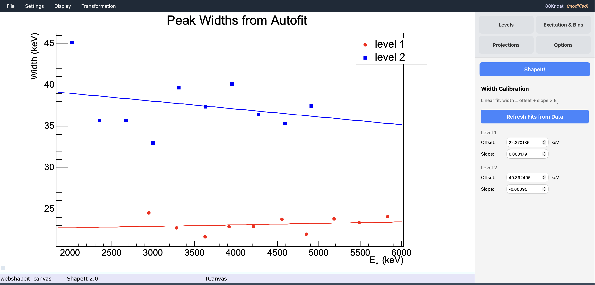

# 4. Options and sewing

All analysis options are in the **Options** tab of the sidebar.

## Analysis options

| Checkbox | Effect |
|---|---|
| **Sewing interpolation** | Applies the symmetric-sewing algorithm to rescale and merge the Level 1 and Level 2 curves into one gSF curve (see [The algorithm](../algorithm.md)). Turn this off to inspect the two raw branches separately. |
| **Display expectation** | Overlays literature (Oslo-method style) expectation values loaded via **Settings → Load gSF literature (Oslo) data...**, for comparison against your extracted points. Greyed out until a file is loaded. |
| **Sliding window variation** | Repeats the extraction with the excitation-energy grid's lower edge shifted towards lower energies in 4 steps (5 realizations total, including the unshifted one), each normalized to the unshifted realization via a χ² fit — a deterministic check of sensitivity to bin placement. |
| **Background subtraction** | Subtracts the background estimated from each level's flanking background windows before computing the gSF (see [Choosing mode and binning](mode-and-binning.md) for exactly how this interacts with Integration vs. Autofit mode). |
| **Use width calibration** | Uses a peak-width calibration (fit once, then reused) instead of re-fitting the width independently in every bin — see below. Only meaningful in Autofit mode after a calibration exists. |

Enabling **Bin size variation** is done in the **Excitation & Bins** tab
(see [Choosing mode and binning](mode-and-binning.md)); the variation itself
interacts with all of the above options here.

Both variation checks can be combined (bin-size as the outer loop, sliding
window repeated for each bin size), and the resulting set of realizations
can be inspected via the display options below.

## Display options

At the bottom of the **Options** tab, the **Display Options** box controls
how results are shown after a run:

| Checkbox | Effect |
|---|---|
| **Show individual data points** | Display each individual gSF point from every excitation-energy bin, colour-coded by level. |
| **Show average values** | Display the pooled, bin-averaged gSF curve — mean and standard deviation computed across all sliding-window and bin-size realizations (see [Running ShapeIt and reading results](running-and-results.md#reading-the-averaged-plot)). |
| **Different colors for peaks** | Plot Peak 1 and Peak 2 contributions in different colours (applies to individual data points only). |

!!! tip "A sensible starting configuration"
    For a first pass: enable **Sewing interpolation** and
    **Background subtraction**, leave the variation checks off, and check
    **Show individual data points**. Once the basic extraction looks
    reasonable, turn on **Sliding window variation** and/or **Bin size
    variation** to gauge systematic uncertainties, then enable
    **Show average values** to get the pooled result.

## Verbose output

**Display → Verbose output** (a toggle in the Display menu) increases the
detail of messages sent to the **Log panel**. Useful for debugging fits or
diagnosing unexpected results.

## Width calibration

Run ShapeIt once in **Autofit** mode with the width left free: for every
excitation-energy bin, the Gaussian fit determines a peak width for Level 1
and Level 2 independently. Open **Display → Width calibration...** to view
the Width Calibration panel, which shows the linear fit

$$
\sigma(E_\gamma) = \text{offset} + \text{slope} \times E_\gamma
$$

through the fitted widths for each level. Click **Refresh Fits from Data**
to refit using the widths from the most recent run.

{ width="80%" }

*Peak widths vs. γ-ray energy for Level 1 (red circles) and Level 2 (blue
squares), each with its own linear fit — the calibration
$\sigma(E_\gamma) = \text{offset} + \text{slope} \times E_\gamma$. Here Level
1 has offset 22.4 keV and near-zero slope; Level 2 has offset 40.9 keV and a
slightly negative slope.*

Once a calibration exists, checking **Use width calibration** in the Options
tab makes every subsequent fit use the calibrated width (evaluated at that
bin's γ-ray energy) instead of fitting the width freely. This often gives
more stable results in bins with low statistics or complicated backgrounds.

The **Width Calibration** panel also lets you edit the offset and slope
directly if you prefer to set them by hand rather than deriving them from
data.

Next: [Running ShapeIt and reading results](running-and-results.md).
