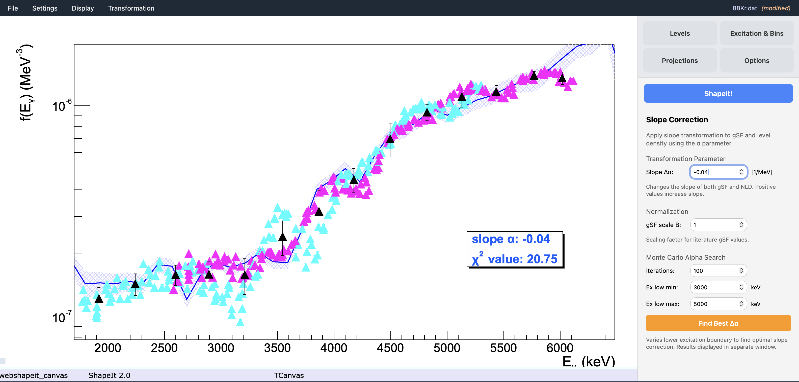

# 5. Running ShapeIt and reading results

## Run the extraction

Once you've set the levels, excitation range, mode, and options, click the
**ShapeIt!** button at the top of the sidebar (just below the tab buttons).
This:

1. Applies your current settings.
2. Steps through the excitation-energy bins, extracting Level 1 and Level 2
   intensities in each (by integration or fit, per your chosen mode).
3. Converts intensities to relative gSF values.
4. Applies sewing (if enabled) to merge the two branches.
5. Plots the resulting gSF graph automatically in the canvas.

Progress messages appear in the **Log panel** at the bottom of the window
as the run proceeds.

!!! note
    If you haven't loaded a matrix yet, ShapeIt will show an error in the
    log panel instead of running.

## Reading the plot

- **Level 1** and **Level 2** points are plotted in distinct colours; the
  merged/sewn curve overlays both once sewing is enabled.
- If **Different colors for peaks** is checked and multiple peaks are
  active per level, Peak 1 and Peak 2 contributions appear in different
  colours within the same level.
- Each point's γ-ray energy (x-axis position) is the **γSF-weighted
  centroid** of that bin's peak-integration window, not the nominal peak
  centre — this keeps the plotted position consistent with where the
  strength actually sits within the window (see
  [The algorithm](../algorithm.md)).
- If **Display expectation** is on, literature values are overlaid for
  comparison.

## Reading the averaged plot

If **Sliding window variation** and/or **Bin size variation** are enabled
(see [Options and sewing](options-and-sewing.md)), ShapeIt produces many
individual realizations of the sewn γSF — one per combination of bin
placement/bin size. Enabling **Show individual data points** in the Display
Options plots every one of them.

{ width="80%" }

*Extracted gSF for* `88Kr` *with individual magenta and cyan points from Level 1
and Level 2, and the Oslo-method literature curve (blue band) overlaid.
The inset shows the current slope $\alpha = -0.04$ and χ² value from
the Slope Correction panel.*

Enabling **Show average values** pools all of those individual realizations
together and re-bins them along the γ-ray energy axis (using the primary
**Bin size [keV]** setting as the pooling width). For each such bin, the
averaged point is placed at:

- **x** — the plain mean of the γ-ray energies of every individual point
  falling in that bin.
- **y** — the plain mean of their γSF values.

and its error bar combines, in quadrature, two things:

- the **standard deviation** of the individual γSF values in that bin
  (reflecting how much the different sliding-window/bin-size realizations
  disagree with each other), and
- the **largest single statistical error bar** among the individual points
  in that bin (so a bin isn't reported as artificially precise just because
  its realizations happened to agree).

This combined averaged curve — not the raw scatter of individual
realizations — is what feeds into the slope determination described in
[Monte Carlo uncertainty and absolute level density](monte-carlo-uncertainty.md).

## Other results views

Once a run has completed, these become available under **Display**:

| Menu item | Shows |
|---|---|
| **Width calibration...** | Peak widths from Autofit mode and their linear calibration — see [width calibration](options-and-sewing.md#width-calibration) |
| **Show level density...** | The extracted level density $\rho(E_x)$ |
| **Show discrete levels...** | Discrete level scheme overlaid on the level density (if a discrete level file is loaded) |
| **Show gSF results...** | A numeric table of $E_\gamma$, gSF, and uncertainty |
| **Show settings file...** | The current settings as they would be written to a `.dat` file |

## Iterating

Adjust the level windows, background windows, binning, or options and press
the **ShapeIt!** button again — each run recomputes from scratch using the
current settings. Once you're happy with a configuration, save it as
described in [Settings files](../settings-files.md) so you can reproduce or
share the analysis later.

To turn your sewn γSF into a properly quantified slope correction and an
absolute partial level density, continue to
[Monte Carlo uncertainty and absolute level density](monte-carlo-uncertainty.md).
